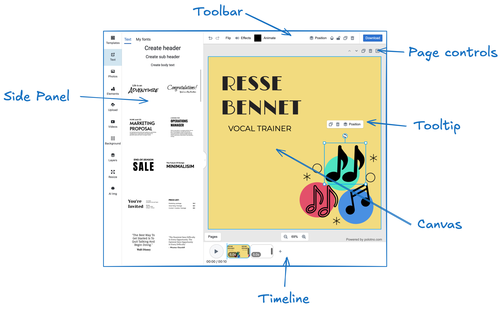

先从界面说起。

ydesign 编辑器有几个主要组件：

## 完全控制侧边栏

你可以完全控制侧边栏。可以去掉默认面板、加入自己的面板，并完全自定义里面的内容。例如，做一个直接从你的后端加载图片的面板。更多说明见 [侧边栏概述](/docs/side-panel-overview)。

## 工具栏、页面控件和提示的定制

你可以修改、移除或添加 [工具栏](/docs/toolbar)、[页面控件](/docs/workspace) 和 [提示](/docs/tooltip) 里的控件和按钮，让界面符合自己的需求。

## 时间轴定制

目前 **时间轴** 组件不能定制。你可以把它去掉，再用 [Store API](/docs/store) 自己实现一版。

## 画布定制

画布组件提供若干样式选项，例如背景色和选中工具的颜色。更多选项见 [工作区文档](/docs/workspace)。

## 整体样式定制

也可以用 [CSS 覆盖](/docs/theme-and-ui-styles) 来调整编辑器的整体样式。

## 数据加载与导出

你可以完全控制数据如何载入编辑器、如何保存和导出。

例如：

- 从你的后端加载自定义模板，或某个用户的设计稿。
- 点击按钮，把 JSON 文件保存到本地。
- 设计一有改动，就自动把设计数据发到你的后端。
- 把设计预览或导出文件上传到 S3。

这些都可以用 [Store API](/docs/store) 实现，让数据流和你的基础设施接上。
